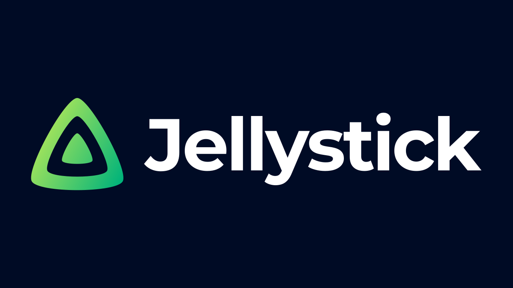

<p align="center">

</p>

<h1 align="center">Jellystick</h1>
<h3 align="center">A Jellyfin client for the Amazon Fire TV Stick, with a streaming-style interface</h3>

<p align="center">
<a href="https://github.com/alexcagira/jellystick/releases/latest">

</a>
<a href="LICENSE">

</a>

</p>

---

Jellystick is a fork of [Jellyfin for Android TV](https://github.com/jellyfin/jellyfin-androidtv) built and tested on the
**Fire TV Stick 4K Max**. It keeps everything the official app does and adds a new home screen, library pages, details pages,
player controls and music experience, inspired by the big streaming apps.

It is an **unofficial** project: it is not made by or affiliated with the Jellyfin team. It installs **next to** the official
Jellyfin app (its own app id, `com.jellystick.tv`), so you can keep both.

Every new screen can be turned off in *Settings → Customization → Home* to go back to the classic interface.

## Where it works

| Device | Status |
|---|---|
| **Fire TV Stick 4K Max** (Fire OS 8) | Tested: this is the device Jellystick is made on |
| Other Fire TV devices (Fire TV Stick 4K, Lite, 3rd gen, Cube; Fire OS 7 or newer) | Should work, not tested |
| Android TV / Google TV (Chromecast with Google TV, Nvidia Shield, Android TVs), Android 6.0 or newer | Should work, not tested |
| Phones and tablets | Not supported (it is a TV app, made for a remote) |

**Server:** a Jellyfin server 10.11 or newer (tested with Jellyfin 12.x).

## What's new compared to Jellyfin for Android TV

### Home
- Streaming-style home screen: floating glass navigation bar and a media bar with title logos over a blurred background.
- Rows: **Continue Watching** (in progress and next episodes, updated the moment you leave the player), **Watchlist**,
  **Trending this week** with rank numbers, **Latest Episodes**, **Latest Films**, **Recently added** and **Favourites**.
- Poster badges: resolution (4K, 1080p…), **Dolby Vision**, **HDR10+ / HDR / HLG**, **Atmos / TrueHD / Digital** and
  **flags of the audio languages** (Latin American Spanish, Brazilian Portuguese… told apart).
- *New episode / New season / New series* labels, no duplicates when a title is in several libraries, configurable row order.
- Starts instantly: it shows what it showed last time and refreshes in the background.

### Movie and TV show libraries
- Each library gets its own page: media bar, pills with the other libraries of the same kind, **Collections** and **Browse**.
- Rows such as *Because you watched…*, IMDb Top 250, genres, studios and networks, tags and seasonal rows (Halloween, Christmas…).
- **Browse**: paged grid with an **A–Z** jump bar and filters: watched state, genres, age rating, **audio language**, sorting and shuffle.
- Collections made and kept up to date by the app: **IMDb Top 250**, by **audio language** and series by **streaming service** (Netflix, HBO Max, Prime Video, Disney+…).

### Details pages
- Full-screen backdrop with logo, rating, genres and overview; *Play / Resume S01:E05*, trailer, watched, **Watchlist** (shared with KefinTweaks on the web).
- Seasons and episodes without leaving the page, with quality badges and flags on every episode, cast and *More like this*.
- The series theme song plays in the background, with fades.

### Player
- Clean screen while playing; seeking with **thumbnails** that only jumps when you press OK.
- Chapters on the seek bar, "Ends at…", a *You're watching* screen when paused, and subtitles that move up above the controls.
- **Skip intro / credits / recap** with Jellyfin media segments or Intro Skipper.
- **Subtitles your way**: Netflix-like, classic, bold, box or yellow styles, outline or shadow, font, size and colours, with a preview.
- When a file can't play directly, it retries by itself with **Dolby Vision as HDR10**, converted audio or transcoding, and remembers it for the whole series.

### Music
- Music page with recommendations, **stations** by artist and genre, and album, artist and playlist pages with a heart on every song.
- Redesigned **Now Playing** with lyrics, a **screensaver** with big lyrics and a **Next up** card in the last seconds of each song.
- **Shared queue**: a QR code lets anyone on your Wi-Fi search your library and add songs from their phone, no app or account needed.

### Fire TV
- Own app, name and logo; the logo sits on the Fire TV tile like any other app.
- **App language** in *Settings → Language*: the TV's, or any of the 60+ translations of Jellyfin for Android TV (Jellystick's own screens are in English and Spanish).
- **Update from Settings**: *Settings → Update Jellystick* downloads and installs the latest GitHub release.
- Optimized release build, smooth scrolling, the player gets priority over everything else, and the Fire TV doesn't sleep while music plays.

The full list is in the release notes: [English](docs/RELEASE_NOTES_EN.md) · [Español](docs/RELEASE_NOTES.md).
The technical notes of every feature (in Spanish) are in [docs/MODERN_HOME.md](docs/MODERN_HOME.md).

## Remote control

| Button | Where | What it does |
|---|---|---|
| **OK** | Anywhere | Opens the title, row or button |
| **Hold OK** | On a poster | Menu: play now, mark as watched / unwatched, add to / remove from watchlist, more info, go to season / show, file info, Identify (admins) |
| **Hold OK** | On a library in the top bar | Move, hide, browse or scan the library |
| **⏯ Play/Pause** | On a poster or a song | Plays it right away (resumes where you left it) |
| **☰ Menu** | Anywhere, while there is music | Stops the music, empties the queue and closes the shared queue |
| **OK** | Player, controls hidden | Pause / play (or *Skip intro* when it shows) |
| **◀ / ▶** | Player | Seek with a thumbnail; hold to go faster. **OK** jumps there; **Back** or 8 seconds without pressing anything keeps playing where it was |
| **▲ / ▼** | Player | Shows the controls (audio, subtitles, chapters, quality, playback mode, speed, subtitle offset) |
| **⏪ / ⏩** | Player | Skip back / forward (the lengths of your Jellyfin settings, 10 s / 30 s by default) |
| **⏪ / ⏩** | Now Playing and its screensaver | Previous / next song |
| **⏯ Play/Pause** | Player, music, screensaver | Pause / play |
| **OK** | Music screensaver | Shows or hides the lyrics (any other button closes the screensaver) |
| **Back** | Player | Hides the controls, cancels a seek or hides the *Skip intro* button; with nothing on screen, closes the player |

## Install on a Fire TV

1. On the Fire TV: *Settings → My Fire TV → Developer options* → turn on **Install unknown apps** for **Downloader**
   (install Downloader from the Amazon Appstore first). If you don't see *Developer options*, open *Settings → My Fire TV → About*
   and press OK seven times on the device name.
2. In Downloader, open the APK of the latest release:
   `https://github.com/alexcagira/jellystick/releases/latest/download/jellystick.apk`
3. Install it and sign in to your server.

From version **1.2.5** on, updates are installed from the app: *Settings → Update Jellystick*. The first time, Fire OS asks to allow
Jellystick to install apps (*Settings → My Fire TV → Developer options → Install unknown apps → Jellystick*).

<!--
## Screenshots

Take them from the Fire TV with adb (Developer options → ADB debugging) and save them in docs/images:

    adb connect <fire-tv-ip>
    adb exec-out screencap -p > docs/images/home.png

| Home | Library | Details |
|---|---|---|
|  |  |  |

| Player | Now Playing | Shared queue |
|---|---|---|
|  |  |  |
-->

## Building

The app uses Gradle and the Android SDK; Android Studio includes everything needed. With the Gradle wrapper:

```shell
./gradlew assembleDebug     # debug build, installs next to the release one
./gradlew assembleRelease   # signed release build (see below)
```

- **Version:** `jellystick.version` in `gradle.properties` is the version of the app and of the GitHub release: raise it before
  every release and tag the release with it (`v1.2.6` for `1.2.6`). Attach the signed APK to the release (any name without "debug",
  e.g. `jellystick.apk`) so *Update Jellystick* finds it.
- **Signing:** set `keystore.file`, `keystore.password`, `signing.key.alias` and `signing.key.password` in `local.properties`
  (not committed). Every update must be signed with the same key.
- **Update repository:** `jellystick.updateRepo` in `gradle.properties` (`owner/name` of the GitHub repository with the releases).

## Credits and license

Jellystick is based on [Jellyfin for Android TV](https://github.com/jellyfin/jellyfin-androidtv) by the
[Jellyfin project](https://jellyfin.org) and its contributors, and keeps its license: the
[GNU General Public License v2.0](LICENSE). Its source code is this repository.

The logo is the Jellyfin logo (CC BY-SA 4.0) in green; the name is drawn with Montserrat Bold (SIL Open Font License).
Jellyfin is a trademark of its owners; Jellystick is not endorsed by them. Fire TV is a trademark of Amazon.
